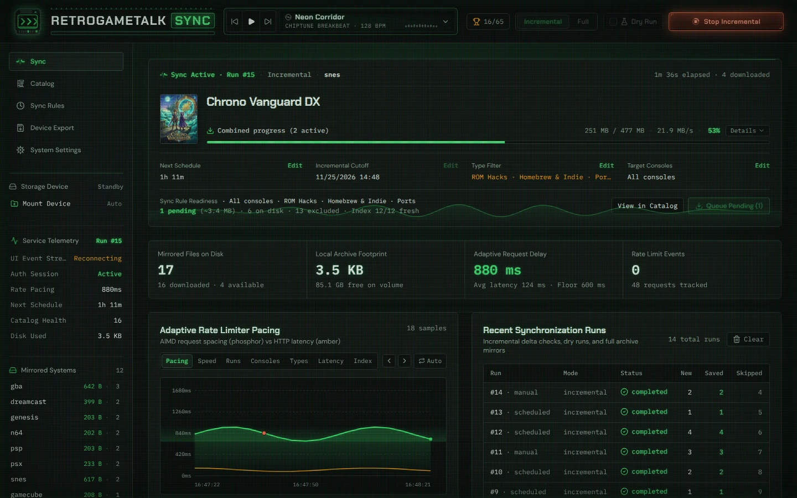
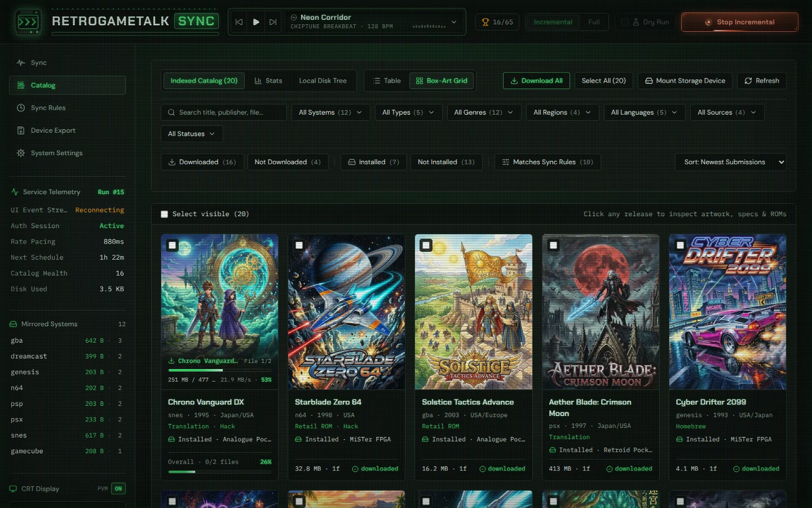
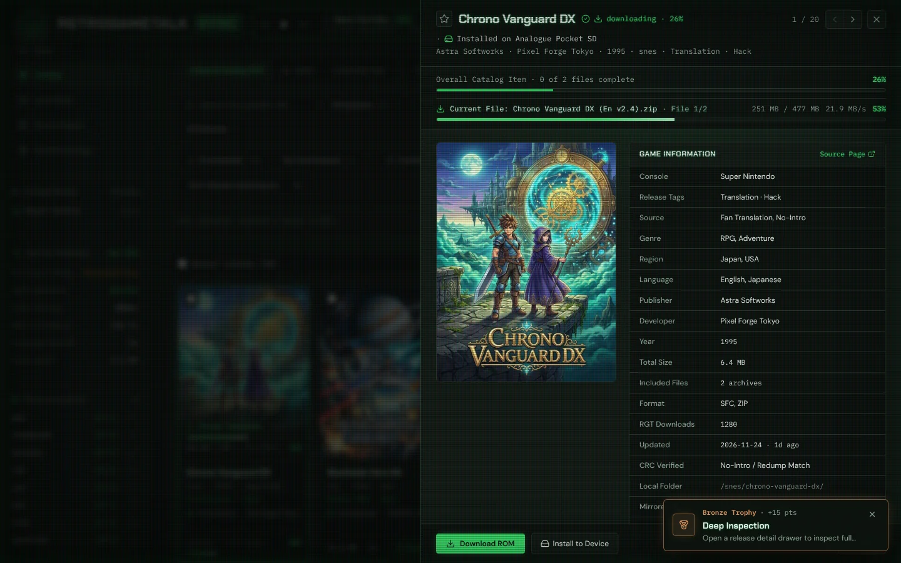
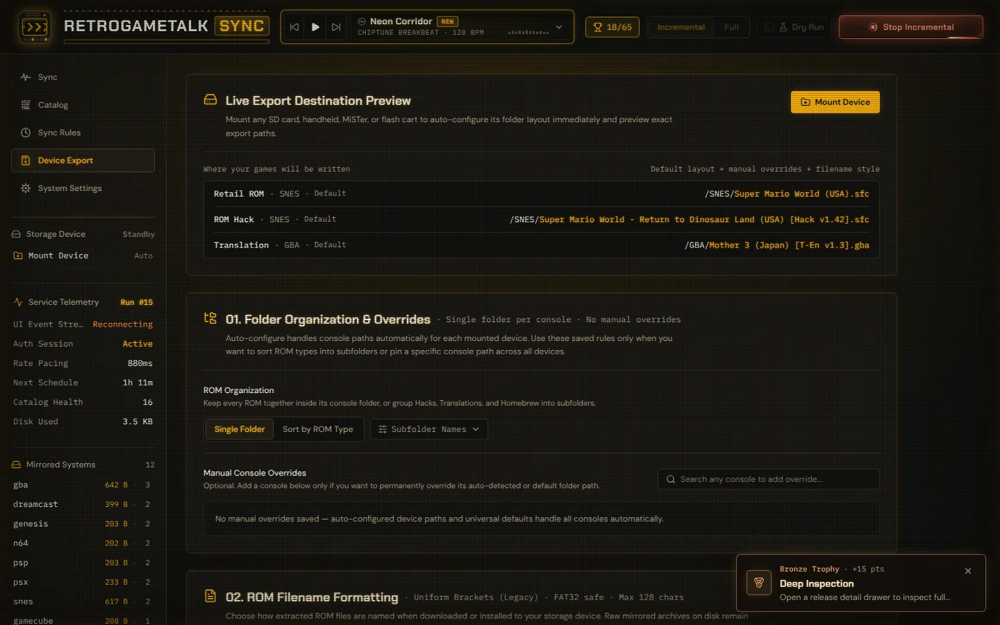

<div align="center">

<p>
  <a href="#quick-start-2-minutes">
    
  </a>
</p>

<h3>Always-On Retro ROM Preservation Mirror, Offline Game Catalog &amp; Direct Handheld SD Installer</h3>

<p>
  <a href="./CHANGELOG.md"></a>
  <a href="./.github/workflows/docker-publish.yml"></a>
  <a href="https://ghcr.io/jeremyj563/retrogametalk-sync"></a>
  <!-- TODO: Replace with live Docker Hub badge once DOCKERHUB_USERNAME/DOCKERHUB_TOKEN are configured and first release image is pushed -->
  
  <!-- TODO: Replace with verified OSI license badge once a LICENSE file is added at repository root -->
  <a href="#license"></a>
</p>

<p>
  <a href="#overview">Overview</a> •
  <a href="#target-audience">Target Audience</a> •
  <a href="#quick-start-2-minutes">Quick Start</a> •
  <a href="#deployment-platforms">Deployment Platforms</a> •
  <a href="#configuration">Configuration</a> •
  <a href="#architecture--observability">Architecture</a> •
  <a href="./docs/features/README.md">Feature Guides</a>
</p>

</div>

---

> [!WARNING]
> **Documentation & Deployment Status (Work in Progress):** This documentation is actively under construction. Not all documented installation paths, platform templates, or marketplace workflows are fully implemented or end-to-end tested yet—expect rough edges and verify commands against your environment before deploying to production.

## Overview

**RetroGameTalk Sync** (`rgt-sync`) is a self-hosted, containerized archival mirror and retro game library manager for `retrogametalk.com/repo/`. It discovers releases across **30+ classic consoles and handhelds**, maintains a searchable offline catalog in SQLite with box art, screenshots, and archive manifests, and lets you export clean, properly named ROMs straight from your browser onto SD cards, flashcarts, and handheld devices—without beating up community servers.

> [!NOTE]
> **Polite by Design:** Built-in adaptive AIMD rate limiting backs off automatically on `429`/`503` responses, honors `Retry-After` headers, deduplicates host-level throttle bursts, and supports decoupled **Catalog Indexing** so you can browse the repository quickly and download only the archives you actually want.

### Visual Preview

<p align="center">
  
</p>

| Sync Overview &amp; Telemetry *(Green · PVM)* | Offline Box-Art Catalog *(Green · PVM)* |
| :---: | :---: |
|  |  |

| Game Detail Drawer *(Green · PVM)* | Direct-to-SD-Card Exporter *(Amber Highlight · PVM)* |
| :---: | :---: |
|  |  |

> *Previews are generated automatically via **Playwright + FFmpeg** (`.github/workflows/update-screenshots.yml`) using an isolated ephemeral demo SQLite library. Run `npm run capture:screenshots` locally (or pass `-- --url http://localhost:3000` to capture your own running instance).*

---

## Target Audience

| Persona | Why `rgt-sync` Fits |
| :--- | :--- |
| **Retro Handheld & Flashcart Players** | Export ready-to-play ROMs straight to SD cards or USB drives via the browser File System Access API—automatically stripping `.txt`/`.nfo` clutter, sorting by console folder mappings, selecting clean patch/translation versions, and tracking **Installed** games per device. |
| **Fan-Translation & ROM Hack Collectors** | Subscribe to specific consoles and release types (**Retail ROMs**, **Hacks**, **Translations** including MTL groupings, **Homebrew**, **Ports**, **Prototypes**) and catch version updates automatically on a cron schedule. |
| **Homelab & NAS Operators** | Run a single-container (`linux/amd64` + `linux/arm64`) appliance with one persistent volume (`/run/repo`), zero external database dependencies, and clean deployment guides for Docker, Compose, Portainer, Dockge, Proxmox LXC, TrueNAS SCALE, and Unraid. |
| **Kubernetes & DevOps Engineers** | Deploy a `StatefulSet` via Helm with `ReadWriteOnce` or console-sharded `ReadWriteMany` storage, Kubernetes `Secret`-locked credentials, `/healthz` + `/readyz` probes, and native Prometheus `/metrics`. |

---

## Key Capabilities

- **Decoupled Catalog Indexing & On-Demand Downloads:** Quickly index titles, box art, release tags, taxonomies, and estimated archive sizes via WordPress REST, then queue individual games, multi-select batches, or entire filtered searches on demand—or toggle **Auto-Download New Releases** for hands-free mirroring.
- **Resilient Multi-Chunk Transfers & Resume:** Segmented HTTP `Range` downloads with `.part.meta.json` `If-Range` verification cleanly resume interrupted transfers across restarts and gracefully abort on `SIGTERM`.
- **Rich Offline Catalog & Lazy Detail Hydration:** Filter across every indexed console by **Downloaded / Not Downloaded**, **Installed / Not Installed**, **Genres**, **Regions**, **Languages**, **Sources**, and **ROM Types** (`ANY`/`ALL` tag matching), with on-demand detail and screenshot caching that keeps un-downloaded release folders off your disk.
- **Direct-to-SD-Card Installer & Prepared ROM Streaming:** Inspect `.zip`/`.7z`/`.rar` contents without pre-unpacking on disk, apply FAT32-safe ROM naming rules, use **Smart ROM Picker** for multi-version archives, and push clean files straight to connected SD cards via customizable console folder mappings.
- **CRT Phosphor Control Console:** Real-time SSE updates, D3 catalog growth and storage analytics, Grafana-style telemetry deck, customizable CRT scanlines/palette/bloom (`Green` / `Amber` / `Cyan`), and **Living UI Motion** presets (`Off` through `Ultra`).

For deep walkthroughs of everyday workflows (plus a small *Back of the Cartridge Manual* hint for curious explorers), see the **[Feature Guides Index](./docs/features/README.md)**.

---

## Quick Start (2 Minutes)

### Prerequisites

- A valid account at `retrogametalk.com` (enter credentials interactively in the **System Settings** / **Operations** tab after launch, or pass via `RGT_USERNAME` / `RGT_PASSWORD`).
- Container runtime (`docker`, `podman`, or Kubernetes) on **`linux/amd64`** or **`linux/arm64`**.
- Host storage mounted to `/run/repo` for mirrored ROMs and `.rgt-data` state.

### Option A — Docker Compose *(Recommended)*

```bash
# 1. Download the repository Compose and environment templates
curl -fsSLO https://raw.githubusercontent.com/jeremyj563/retrogametalk-sync/main/docker-compose.yml
curl -fsSL https://raw.githubusercontent.com/jeremyj563/retrogametalk-sync/main/.env.example -o .env

# 2. (Optional) Edit .env to pre-lock credentials or schedules, or leave empty to configure in UI
# 3. Start RetroGameTalk Sync
docker compose up -d
```

Open **`http://localhost:3000`** in your browser, configure your credentials and target consoles in the web console, and launch your first sync or catalog index.

### Option B — Single `docker run` Command

```bash
docker run -d \
  --name rgt-sync \
  --restart unless-stopped \
  -p 3000:3000 \
  -v "$(pwd)/mirror-data:/run/repo" \
  ghcr.io/jeremyj563/retrogametalk-sync:1.7.0
```

---

## Deployment Platforms

Every platform below has a complete, self-contained installation, storage, upgrade, and troubleshooting guide inside [`/docs/deploy/`](./docs/deploy/README.md):

| Platform | Best For | Install Method | Setup Time | Architecture | Guide |
| :--- | :--- | :--- | :--- | :--- | :--- |
| **Deployment Hub** | Storage contract, all env vars & probes | Reference | — | `amd64` / `arm64` | **[`docs/deploy/README.md`](./docs/deploy/README.md)** |
| **Docker / Podman CLI** | Desktops, Linux hosts, quick evaluation | `docker run` / `podman run` | ~1 min | `amd64` / `arm64` | **[`docs/deploy/docker.md`](./docs/deploy/docker.md)** |
| **Docker / Podman Compose** | Reproducible single-host homelab stacks | `docker compose up -d` | ~2 min | `amd64` / `arm64` | **[`docs/deploy/docker-compose.md`](./docs/deploy/docker-compose.md)** |
| **Portainer & Dockge** | Web-managed Compose stacks & GitOps updates | Stack Paste / Git Repo | ~3 min | `amd64` / `arm64` | **[`docs/deploy/portainer-and-dockge.md`](./docs/deploy/portainer-and-dockge.md)** |
| **Proxmox VE (LXC)** | Hypervisors (OCI LXC on PVE 9.1+ or Docker LXC) | OCI Image / `pct` + `mp0` | ~5 min | `amd64` / `arm64` | **[`docs/deploy/proxmox-lxc.md`](./docs/deploy/proxmox-lxc.md)** |
| **TrueNAS SCALE (CE)** | Electric Eel (24.10+) ZFS datasets | Custom App YAML (`Install via YAML`) | ~4 min | `amd64` | **[`docs/deploy/truenas-scale.md`](./docs/deploy/truenas-scale.md)** |
| **Unraid** | NVMe `appdata` + Array ROM share separation | Template XML / Add Container | ~4 min | `amd64` | **[`docs/deploy/unraid.md`](./docs/deploy/unraid.md)** |
| **Kubernetes & Helm** | k3s, Talos, MicroK8s, StatefulSet & metrics | Local Chart / OCI Chart | ~5 min | `amd64` / `arm64` | **[`docs/deploy/kubernetes-helm.md`](./docs/deploy/kubernetes-helm.md)** |

> [!TIP]
> **Ready-to-use platform templates** are staged directly in the repository:
> [`docker-compose.yml`](./docker-compose.yml) · [`deploy/truenas/docker-compose.yaml`](./deploy/truenas/docker-compose.yaml) · [`deploy/unraid/retrogametalk-sync.xml`](./deploy/unraid/retrogametalk-sync.xml) · [`k8s/charts/retrogametalk-sync`](./k8s/charts/retrogametalk-sync)

---

## Configuration

`rgt-sync` uses a **two-tier configuration model**:

1. **Dynamic UI & SQLite Persistence (Default):** Leave optional environment variables unset and manage everything interactively in the web console. Settings persist across restarts in `/run/repo/.rgt-data/scraper.db` (with sensitive credentials encrypted using AES-256-GCM).
2. **Infrastructure-as-Code Env Locks:** Any setting supplied via container environment variables (`RGT_USERNAME`, `CRON_SCHEDULE`, `SCRAPER_SYSTEM_FILTER`, rate-limit tuning, etc.) becomes authoritative at startup and shows a visual lock indicator in the UI so Compose/Helm configs stay the source of truth.

### Most Common Environment Variables

| Variable | Default | Description |
| :--- | :--- | :--- |
| `PORT` | `3000` | HTTP port for the web console, REST/SSE API, health probes, and `/metrics`. |
| `DOWNLOAD_DIR` | `/run/repo` | Root directory where `<system>/<release>/<files>` mirrors are written. |
| `DATA_DIR` | `/run/repo/.rgt-data` | SQLite database (`scraper.db`), `.keyfile`, `cookies.json`, and lazy cover/screenshot cache. |
| `RGT_USERNAME` | `""` | Optional RetroGameTalk username (locks UI field when set). |
| `RGT_PASSWORD` | `""` | Optional RetroGameTalk password (locks UI field when set). |
| `ENCRYPTION_KEY` | Auto `.keyfile` | Optional secret (`>=16` chars) hashed to AES-256-GCM key for SQLite credential storage. |
| `CRON_SCHEDULE` | `"0 */6 * * *"` | 5-field cron expression for scheduled background syncs. |
| `SCRAPER_SYSTEM_FILTER` | `""` | Optional comma-separated console slugs (useful for sharding or focused mirroring). |
| `SCRAPER_RELEASE_TYPE_FILTER` | `""` | Optional comma-separated allowed release tags (e.g., `Retail ROM,Translation,Hack`). |
| `SCRAPER_DEBUG` | `"false"` | Enables verbose scrape, HTTP/WP REST, download, archive, and SD-install telemetry. |

See the **[Complete Environment Variable Reference](./docs/deploy/README.md#complete-environment-variable-reference)** for chunk acceleration, AIMD rate-limiting, `GIT_URL`, and `LOG_LEVEL` variables.

---

## Architecture & Observability

```
┌────────────────────────────────────────────────────────────────────────────┐
│ Browser Client (React 19 + Vite + Tailwind v4 + D3 + File System Access)   │
│ · Sync Overview · Catalog & Stats · Sync Rules · Device Export · Settings  │
└───────────────────────────────┬────────────────────────────────────────────┘
                                │ REST + SSE (/api/*, /api/events)
                                ▼
┌────────────────────────────────────────────────────────────────────────────┐
│ Node.js Server + ScraperOrchestrator (server.ts, port 3000)                │
│ · Cron Scheduler (croner) & WP REST / HTML Client (impit + tough-cookie)   │
│ · Adaptive AIMD Rate Limiter & Multi-Chunk HTTP Range Downloader           │
│ · On-Demand Archive Inspector & Clean ROM Streamer (7zz / 7zip-bin / yazl) │
│ · Cloud-Native Probes: GET /healthz · GET /readyz · GET /metrics (Prom)    │
└───────────────────────────────┬────────────────────────────────────────────┘
                                │ Single-Mount Persistence (/run/repo)
                                ▼
┌────────────────────────────────────────────────────────────────────────────┐
│ Persistent Volume (/run/repo)                                              │
│ ├── <system>/<release>/   Mirrored archives, covers, screenshots & meta    │
│ └── .rgt-data/            Hidden SQLite WAL DB, .keyfile, cookies & cache  │
└────────────────────────────────────────────────────────────────────────────┘
```

- **Technical Specifications:** [Backend & Persistence](./docs/specs/backend-and-persistence.md) · [Frontend & Browser APIs](./docs/specs/frontend-and-browser-apis.md) · [Deployment & DevOps](./docs/specs/deployment-and-devops.md)
- **Troubleshooting:** [Common Auth, Throttle, Archive & Storage Issues](./docs/troubleshooting/README.md)

---

## Versioning & Roadmap

RetroGameTalk Sync adheres to strict **`1.x.y` Semantic Versioning** with bare SemVer tags (e.g., `1.7.0`, no `v` prefix) kept in lockstep across `package.json`, `k8s/charts/retrogametalk-sync/Chart.yaml`, GitHub Releases, container tags, and OCI Helm charts. See [`CHANGELOG.md`](./CHANGELOG.md) and [`docs/release/README.md`](./docs/release/README.md).

### Publishing & Marketplace Roadmap

- [x] In-repo multi-platform deployment hub (`/docs/deploy/`) and staged templates
- [x] Multi-arch (`linux/amd64` + `linux/arm64`) GitHub Actions Buildx pipeline with SBOM/provenance and OCI Helm chart packaging
- [x] Secret-gated Docker Hub publishing (`DOCKERHUB_USERNAME` / `DOCKERHUB_TOKEN`)
- [ ] <!-- TODO: Configure DOCKERHUB_USERNAME, DOCKERHUB_TOKEN, and optional DOCKERHUB_REPOSITORY secret/variable in GitHub Actions and verify first tagged Docker Hub push --> Public Docker Hub mirror activation
- [ ] <!-- TODO: Add OSI LICENSE file, upload/verify 256x256 PNG app icon URL, open Unraid Forums [Support] thread, and submit template via ca.unraid.net --> Unraid Community Applications (CA) catalog submission
- [ ] <!-- TODO: Prepare and submit PR to github.com/truenas/apps under ix-dev/community/retrogametalk-sync/ once volume/env contract has baked across initial public releases --> TrueNAS SCALE Community train (`truenas/apps`) submission

---

## Contributing & Local Development

```bash
# 1. Install dependencies (requires Node.js 22+ and build tools for better-sqlite3)
npm install

# 2. Configure local env vars (uses local ./data paths safely outside /run/repo)
cp .env.example .env

# 3. Start unified Express + Vite dev server on http://127.0.0.1:3000
npm run dev

# 4. Run tests, TypeScript checks, and production bundle verification
npx tsx --test tests/*.test.ts
npm run lint
npm run build
```

> [!NOTE]
> Contributions are welcome! See [`AGENTS.md`](./AGENTS.md) for repository versioning/changelog conventions before opening pull requests.
<!-- TODO: Add CONTRIBUTING.md and issue/PR templates (.github/ISSUE_TEMPLATE/) if opening the repository to external community contributors -->

---

## Support & Community

- **Issues & Bug Reports:** <!-- TODO: Confirm or link GitHub Issues URL (e.g., https://github.com/jeremyj563/retrogametalk-sync/issues) --> [`GitHub Issues`](https://github.com/jeremyj563/retrogametalk-sync/issues)
- **Community Discussions / Chat:** <!-- TODO: Add GitHub Discussions, Discord invite, or Unraid Forum [Support] thread URL once created --> *TODO: Link community support channel or Unraid forum thread*
- **Diagnostic Logs:** Enable `SCRAPER_DEBUG=true` (or **Debug Logging** in System Settings) before sharing logs, and redact credentials/session cookies.

---

## License

<!-- TODO: Choose an open-source license (e.g., MIT, Apache-2.0, or GPL-3.0), commit a root LICENSE file, and update package.json + this section. Note: An OSI-approved LICENSE file is required prior to Unraid CA and TrueNAS truenas/apps submissions. -->
**TODO:** Add an OSI-approved `LICENSE` file at the repository root and document the license terms here before public marketplace submission.
