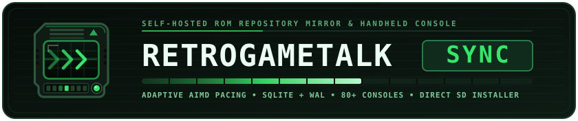

<div align="center">

<p>
  <a href="#quick-start-2-minutes">
    
  </a>
</p>

<h3>Self-Hosted Retro Game Content Management System, Preservation Mirror &amp; Multi-Handheld Installer</h3>

<p>
  <a href="./CHANGELOG.md"></a>
  <a href="./.github/workflows/docker-publish.yml"></a>
  <a href="https://ghcr.io/jeremyj563/retrogametalk-sync"></a>
  <!-- TODO: Replace with live Docker Hub badge once DOCKERHUB_USERNAME/DOCKERHUB_TOKEN are configured and first release image is pushed -->
  
  <!-- TODO: Replace with verified OSI license badge once a LICENSE file is added at repository root -->
  <a href="#license"></a>
</p>

<p>
  <a href="#overview">Overview</a> •
  <a href="#target-audience">Target Audience</a> •
  <a href="#key-capabilities">Capabilities</a> •
  <a href="#quick-start-2-minutes">Quick Start</a> •
  <a href="#deployment-platforms">Deploy</a> •
  <a href="#configuration">Configuration</a> •
  <a href="#architecture--observability">Architecture</a> •
  <a href="./docs/features/README.md">Feature Guides</a>
</p>

</div>

---

> [!WARNING]
> **Documentation & Deployment Status (Work in Progress):** Some marketplace listings (Docker Hub public mirror, Unraid CA, TrueNAS Community train) are still being finalized. Verify environment variables and volume mounts against your host before deploying to production.

## Overview

**RetroGameTalk Sync** (`rgt-sync`) is a self-hosted **retro game content management system (CMS)**, automated preservation mirror, and multi-handheld deployment console for `retrogametalk.com/repo/`.

What started as a polite archival scraper has grown into a complete **end-to-end library & device manager** for retro collectors:

- **Discover & Preserve Automatically:** Discovers live platforms across **38+ consoles, handhelds, and classic computers** via RetroGameTalk's WordPress REST registry, maintains a fast searchable SQLite catalog with box art, full-res screenshots, and archive manifests, and keeps your local NAS/server mirrored on an unattended cron schedule.
- **Curate Your Personal Library:** Organize games with **Favorites**, **Custom Collections / Handheld Loadouts**, per-game **Sync Rule Overrides (`Pin` / `Ignore`)**, deep multi-facet `ANY`/`ALL` filters, an in-place **`.zip`/`.7z`/`.rar`/`.tar` Archive Explorer**, and a self-contained **Local Disk Tree** file browser.
- **Manage a Fleet of Handhelds, SD Cards & Flashcarts:** Plug in any SD card or USB drive and deploy cleanly extracted, **No-Intro + T-En** formatted ROMs straight from your browser—with automatic hardware card identity stamping (`.rgt-device.json`), per-mount folder **Auto-Configure** (OnionOS, GarlicOS, ES-DE, Batocera, EmuDeck, MiSTer, Analogue Pocket, EverDrive), live **Installed ROM Update Detection** (`Update ready` / `Update on RGT`), 1-click live install queueing, in-place upgrades, and safe direct **Uninstall** per device.

> [!NOTE]
> **Polite by Design:** Built-in adaptive AIMD rate limiting backs off automatically on `429`/`503` responses, honors `Retry-After` headers, supports **Index-First** fast delta updates (`modified_after`) so you only download the archives you actually want, and hot-reloads pacing, concurrency, and console filters mid-run without restarting transfers.

### Visual Preview

<p align="center">
  
</p>

| Sync Overview &amp; Telemetry *(Green · PVM)* | Offline Box-Art Catalog *(Green · PVM)* |
| :---: | :---: |
|  |  |

| Game Detail Drawer *(Green · PVM)* | Direct-to-SD-Card Exporter *(Amber Highlight · PVM)* |
| :---: | :---: |
|  |  |

> *Previews are generated automatically via **Playwright + FFmpeg** (`.github/workflows/update-screenshots.yml`) using an isolated ephemeral demo SQLite library and published to the rolling [`readme-assets`](https://github.com/jeremyj563/retrogametalk-sync/releases/tag/readme-assets) GitHub Release so binary screenshots never bloat git history. Run `npm run capture:screenshots` locally (or pass `-- --url http://localhost:3000` to capture your own running instance).*

---

## Target Audience

| Persona | Why `rgt-sync` Fits |
| :--- | :--- |
| **Multi-Handheld & Flashcart Collectors** | Track separate installed libraries across **10+ handhelds, SD cards, MiSTer setups, Analogue Pockets, and flashcarts** with hardware-pinned `.rgt-device.json` card IDs, automatic folder-layout detection, live update badges, 1-click batch installs, and direct device uninstalls—even browsing any saved device's installed games offline while its SD card is unplugged. |
| **Fan-Translation & ROM Hack Curators** | Subscribe to specific consoles and release types (**Retail ROMs**, **Translations** incl. MTL groupings, **Hacks**, **Homebrew**, **Ports**, **Undubs**, **Prototypes**), build **Collections / Loadouts**, **Pin** or **Ignore** individual titles, and catch `v1.x → v2.x` patch updates automatically with in-place SD card upgrades. |
| **Homelab & NAS Archivists** | Run a single-container (`linux/amd64` + `linux/arm64`) appliance with one persistent volume (`/run/repo`), zero external database dependencies, optional self-hosted login protection (`APP_AUTH_PASSWORD`), secret-free JSON config Backup & Restore, and native RAR4/RAR5/7z/ZIP streaming. |
| **Kubernetes & DevOps Engineers** | Deploy a `StatefulSet` via Helm (with deployed version/image summary in `NOTES.txt`), `ReadWriteOnce` or console-sharded `ReadWriteMany` storage, Kubernetes `Secret`-locked credentials, automatic crash-loop-safe download queue recovery across pod restarts, `/healthz` + `/readyz` probes, and Prometheus `/metrics`. |

---

## Key Capabilities

### Retro Game Content Management & Library Curation
- **Visual Offline Catalog & Multi-Facet Filtering:** Browse every indexed console in **Box-Art Grid**, **Detailed List**, or **Local Disk Tree** modes. Filter simultaneously by **Systems**, **ROM Types**, **Genres**, **Regions**, **Languages**, **Sources**, **Sync Status**, **`Matches Sync Rules`**, **Downloaded / Not Downloaded**, and per-device **Installed / Not Installed / Updates** (`ANY`/`ALL` tag matching), with sorting including **`Recently Installed`**.
- **Favorites, Custom Collections & Per-Game Sync Overrides:** Star favorites, group titles into reusable **Collections / Handheld Loadouts** (with 1-click **Queue Missing** and **Install to `<Device>`** banners), and set per-game **`Pin`** (always mirror regardless of global rules) or **`Ignore`** (skip during automatic syncs) overrides.
- **In-Place Archive Explorer & Local Disk Explorer:** Browse inside mirrored `.zip`, `.7z`, `.rar` (native `unrar` for RAR4/RAR5), and `.tar` archives without unpacking to disk—complete with folder breadcrumbs, entry search, UTF-8 text preview for `.txt`/`.nfo`/`.cue`/`.m3u` files, and single-entry streaming downloads—directly inside both the **Game Detail Drawer** and **Catalog → Local Disk Tree**.

### Multi-Handheld & SD Card Fleet Management
- **Hardware-Pinned Device Profiles & Fleet Drawer:** Mount SD cards, USB drives, or local ROM folders via Chromium's File System Access API. Cards are automatically stamped with a tiny hidden `.rgt-device.json` ID (paired with `isSameEntry()` handle matching and firmware/label auto-detection for OnionOS, GarlicOS, muOS, Batocera, KNULLI, Analogue Pocket, MiSTer, EverDrive, and ES-DE), remembered in IndexedDB for 1-click reconnects, and managed in a searchable **Devices Fleet Drawer** with custom icons, colors, pinning, archiving, and offline catalog filtering.
- **Automatic Per-Mount Folder Auto-Configure:** Mounting any device scans and activates its console folder layout automatically across **75+ retro platforms** using a 3-layer model (`Universal Defaults` → `Mounted Device Auto-Config` → `Saved Manual Overrides`), inferring nested ROM roots (`Roms/`, `games/`, `Emulation/roms/`) and shorthand ROM-type subfolder naming/casing conventions (`Hacks`, `trans`, `homebrew`) even for newly added consoles.
- **No-Intro + T-En Hybrid ROM Naming & Smart Multi-Variant Disambiguation:** Format prepared ROMs cleanly with syntax-highlighted **10-type live previews** (testable against **Real Catalog Games**), cursor-aware token editing, optional per-type templates, FAT32 sanitization, **Smart ROM Picker** automatic best-version selection, and automatic filename collision disambiguation when installing multiple variants or discs from the same release.
- **Live Install Queueing, Update Tracking & Safe Uninstall:** Click **Install**, **Update**, or **Reinstall** on games across the UI while transfers are running to append directly to the live byte-progress install queue; track **Update ready** (local newer mirror) vs. **Update on RGT** (upstream update) per device with 1-click in-place upgrades; and safely **Uninstall from `<Device>`** (single or cross-page bulk with mid-run cancel) without ever touching your local archival mirror.

### Automated Preservation Mirroring & Operational Resilience
- **Authoritative Platform Discovery & Fast Delta Indexing:** Merges RetroGameTalk's live WordPress REST platform registry (`/wp-json/wp/v2/types`) with homepage discovery so all **38+ live platforms** (including unlisted CPTs like `amiga` and `sega-pico`) appear automatically, using fast `modified_after` cursor deltas, 12-hour freshness indicators, and self-healing backfill for incomplete scans.
- **Universal Live Mid-Run Hot-Reloading:** Edit **Target Consoles**, **Allowed Release Types**, **Request Pacing**, **Parallel Workers**, **Chunk Concurrency**, or **Retries** while a Sync, Download Queue, or Catalog Indexer run is active—changes take effect immediately on the next file or console without restarting the run.
- **Automatic Download Queue Recovery & Crash-Loop Backoff:** Interrupted queues (from `SIGTERM`, `SIGKILL`, OOM kills, or upgrades) resume automatically on startup using a persistent exponential backoff schedule (`5s → 15s → 45s → 2m → 5m`) with a 5-attempt circuit breaker and explicit **Pause** / **Resume Now** controls, backed by atomic `.part` + HTTP `Range` `If-Range` transfer resuming.
- **Security & Portability:** Optional zero-dependency self-hosted UI/API lock (`APP_AUTH_PASSWORD` with `scrypt`, HMAC-SHA256 `HttpOnly` session cookies, CSRF protection, and login rate limiting), AES-256-GCM at-rest credential encryption with zero plaintext exposure in `/api/config`, and **Secret-Free JSON Configuration Backup & Restore**.

### CRT Phosphor Control Console
- **Broadcast-Grade CRT Aesthetic:** Live **Hero Showcase** with adaptive box-art framing and crossfades, **Speed-Reactive Sync Wave**, real-time SSE telemetry and D3 analytics, **7 Phosphor Palettes** (`Green`, `Amber`, `Cyan` + 4 unlockable collector palettes), **4 Monitor Presets** (`Subtle`, `PVM`, `Arcade`, `BVM`), **5 Living UI Motion** tiers (`Off`–`Ultra`), CRT phosphor-dissolve confirmation notices, palette-synced SVG cartridge favicon, and a built-in **7-track Web Audio VGM Synthesizer** paired with the **Trophy Case**.

For hands-on walkthroughs of everyday workflows (plus a small *Back of the Cartridge Manual* hint for curious explorers), see the **[Feature Guides Index](./docs/features/README.md)**.

---

## Quick Start (2 Minutes)

### Prerequisites

- A valid account at `retrogametalk.com` (enter credentials interactively in **System Settings** after launch, or pass via `RGT_USERNAME` / `RGT_PASSWORD`).
- Container runtime (`docker`, `podman`, or Kubernetes) on **`linux/amd64`** or **`linux/arm64`**.
- Host storage mounted to `/run/repo` for mirrored ROMs and `.rgt-data` state.

### Option A — Docker Compose *(Recommended)*

```bash
# 1. Download the repository Compose and environment templates
curl -fsSLO https://raw.githubusercontent.com/jeremyj563/retrogametalk-sync/main/docker-compose.yml
curl -fsSL https://raw.githubusercontent.com/jeremyj563/retrogametalk-sync/main/.env.example -o .env

# 2. (Optional) Edit .env to pre-lock credentials, app auth, or schedules, or leave empty to configure in UI
# 3. Start RetroGameTalk Sync
docker compose up -d
```

Open **`http://localhost:3000`** in your browser, configure your credentials in **System Settings**, pick target consoles in **Sync Rules**, and mount an SD card from the left sidebar **Storage Device** bay whenever you're ready to deploy games.

### Option B — Single `docker run` Command

```bash
docker run -d \
  --name rgt-sync \
  --restart unless-stopped \
  -p 3000:3000 \
  -v "$(pwd)/mirror-data:/run/repo" \
  ghcr.io/jeremyj563/retrogametalk-sync:1.44.4
```

---

## Deployment Platforms

Every platform below has a complete, self-contained installation, storage, upgrade, and troubleshooting guide inside [`/docs/deploy/`](./docs/deploy/README.md):

| Platform | Best For | Install Method | Setup Time | Architecture | Guide |
| :--- | :--- | :--- | :--- | :--- | :--- |
| **Deployment Hub** | Storage contract, all env vars & probes | Reference | — | `amd64` / `arm64` | **[`docs/deploy/README.md`](./docs/deploy/README.md)** |
| **Docker / Podman CLI** | Desktops, Linux hosts, quick evaluation | `docker run` / `podman run` | ~1 min | `amd64` / `arm64` | **[`docs/deploy/docker.md`](./docs/deploy/docker.md)** |
| **Docker / Podman Compose** | Reproducible single-host homelab stacks | `docker compose up -d` | ~2 min | `amd64` / `arm64` | **[`docs/deploy/docker-compose.md`](./docs/deploy/docker-compose.md)** |
| **Portainer & Dockge** | Web-managed Compose stacks & GitOps updates | Stack Paste / Git Repo | ~3 min | `amd64` / `arm64` | **[`docs/deploy/portainer-and-dockge.md`](./docs/deploy/portainer-and-dockge.md)** |
| **Proxmox VE (LXC)** | Hypervisors (OCI LXC on PVE 9.1+ or Docker LXC) | OCI Image / `pct` + `mp0` | ~5 min | `amd64` / `arm64` | **[`docs/deploy/proxmox-lxc.md`](./docs/deploy/proxmox-lxc.md)** |
| **TrueNAS SCALE (CE)** | Electric Eel (24.10+) ZFS datasets | Custom App YAML (`Install via YAML`) | ~4 min | `amd64` | **[`docs/deploy/truenas-scale.md`](./docs/deploy/truenas-scale.md)** |
| **Unraid** | NVMe `appdata` + Array ROM share separation | Template XML / Add Container | ~4 min | `amd64` | **[`docs/deploy/unraid.md`](./docs/deploy/unraid.md)** |
| **Kubernetes & Helm** | k3s, Talos, MicroK8s, StatefulSet & metrics | Local Chart / OCI Chart | ~5 min | `amd64` / `arm64` | **[`docs/deploy/kubernetes-helm.md`](./docs/deploy/kubernetes-helm.md)** |

> [!TIP]
> **Ready-to-use platform templates** are staged directly in the repository:
> [`docker-compose.yml`](./docker-compose.yml) · [`deploy/truenas/docker-compose.yaml`](./deploy/truenas/docker-compose.yaml) · [`deploy/unraid/retrogametalk-sync.xml`](./deploy/unraid/retrogametalk-sync.xml) · [`k8s/charts/retrogametalk-sync`](./k8s/charts/retrogametalk-sync)

---

## Configuration

`rgt-sync` uses a **two-tier configuration model**:

1. **Dynamic UI & SQLite Persistence (Default):** Leave optional environment variables unset and manage everything interactively in **Sync Rules**, **Device Export**, and **System Settings**. Settings persist in `/run/repo/.rgt-data/scraper.db` (with sensitive credentials encrypted using AES-256-GCM) and can be exported/restored anytime via **Secret-Free JSON Configuration Backup**.
2. **Infrastructure-as-Code Env Locks:** Any setting supplied via container environment variables (`RGT_USERNAME`, `CRON_SCHEDULE`, `SCRAPER_SYSTEM_FILTER`, rate-limit tuning, etc.) becomes authoritative at startup and displays an amber lock badge + tooltip in the UI so Compose/Helm configs stay the source of truth.

### Most Common Environment Variables

| Variable | Default | Description |
| :--- | :--- | :--- |
| `PORT` | `3000` | HTTP port for the web console, REST/SSE API, health probes, and `/metrics`. |
| `DOWNLOAD_DIR` | `/run/repo` | Root directory where `<system>/<release>/<files>` mirrors are written. |
| `DATA_DIR` | `/run/repo/.rgt-data` | SQLite database (`scraper.db`), `.keyfile`, `cookies.json`, and lazy cover/screenshot cache. |
| `RGT_USERNAME` | `""` | Optional RetroGameTalk username (locks UI field when set). |
| `RGT_PASSWORD` | `""` | Optional RetroGameTalk password (locks UI field when set; never sent back to browser). |
| `ENCRYPTION_KEY` | Auto `.keyfile` | Optional secret (`>=16` chars) hashed to AES-256-GCM key for SQLite credential storage. |
| `APP_AUTH_PASSWORD` | `""` | Optional self-hosted UI/API lock password (enables CRT login screen + signed `HttpOnly` sessions). |
| `APP_AUTH_USERNAME` | `""` | Optional username paired with `APP_AUTH_PASSWORD` (omit for password-only unlock). |
| `CRON_SCHEDULE` | `"0 */6 * * *"` | 5-field cron expression for scheduled background syncs. |
| `SCRAPER_SYSTEM_FILTER` | `""` | Optional comma-separated console slugs (useful for sharding or focused mirroring). |
| `SCRAPER_RELEASE_TYPE_FILTER` | `""` | Optional comma-separated allowed release tags (e.g., `Retail ROM,Translation,Hack`). |
| `SCRAPER_DEBUG` | `"false"` | Enables verbose scrape, HTTP/WP REST, download, archive, and SD-install telemetry. |

See the **[Complete Environment Variable Reference](./docs/deploy/README.md#5-complete-environment-variable-reference)** for chunk acceleration, AIMD rate-limiting, `APP_AUTH_SESSION_SECRET`, `GIT_URL`, and `LOG_LEVEL` variables.

---

## Architecture & Observability

```text
┌────────────────────────────────────────────────────────────────────────────┐
│ Browser Client (React 19 + Vite 8 + Tailwind v4 + D3 + Web Audio VGM)      │
│ · Sync · Catalog (Grid/List/Disk) · Sync Rules · Device Export · Settings  │
│ · File System Access API + IndexedDB Device Handles + Direct SD Streaming  │
└───────────────────────────────┬────────────────────────────────────────────┘
                                │ REST + SSE (/api/*, /api/events)
                                ▼
┌────────────────────────────────────────────────────────────────────────────┐
│ Node.js 22 Server + ScraperOrchestrator (server.ts, port 3000)             │
│ · Optional Self-Hosted AppAuth Gate (scrypt + HMAC-SHA256 HttpOnly Cookie) │
│ · Live-Reloadable Cron Scheduler (croner) & WP REST/HTML Client (impit)    │
│ · Adaptive AIMD Limiter, Multi-Chunk Range Downloader & Auto-Resume Backoff│
│ · Zero-Temp-Disk Archive Engine (unrar / 7zip / bsdtar / yazl)             │
│ · Cloud-Native Probes: GET /healthz · GET /readyz · GET /metrics (Prom)    │
└───────────────────────────────┬────────────────────────────────────────────┘
                                │ Single-Mount Persistence (/run/repo)
                                ▼
┌────────────────────────────────────────────────────────────────────────────┐
│ Persistent Volume (/run/repo)                                              │
│ ├── <system>/<release>/   Mirrored archives, covers, screenshots & meta    │
│ └── .rgt-data/            SQLite WAL DB (v1–v30), .keyfile, cookies, cache │
└────────────────────────────────────────────────────────────────────────────┘
```

- **Feature Guides:** [Overview & 5 Workspaces](./docs/features/README.md) · [Catalog, Collections & Archive Explorer](./docs/features/catalog-and-collection-curation.md) · [Multi-Device Fleet & Handheld SD Installer](./docs/features/handheld-and-sd-card-installer.md) · [Preservation Mirroring, Live Reload & Auto-Recovery](./docs/features/mirroring-and-preservation.md)
- **Technical Specifications:** [Architecture Matrix](./docs/specs/README.md) · [Backend & Persistence](./docs/specs/backend-and-persistence.md) · [Frontend & Browser APIs](./docs/specs/frontend-and-browser-apis.md) · [Deployment & DevOps](./docs/specs/deployment-and-devops.md)
- **Troubleshooting:** [Debug Logging, Archive, Auth & Storage Issues](./docs/troubleshooting/README.md)

---

## Versioning & Roadmap

RetroGameTalk Sync adheres to strict **`1.x.y` Semantic Versioning** with bare SemVer tags (e.g., `1.44.4`, no `v` prefix) kept in lockstep across `package.json`, `k8s/charts/retrogametalk-sync/Chart.yaml`, GitHub Releases, container tags, and OCI Helm charts. See [`CHANGELOG.md`](./CHANGELOG.md) and [`docs/release/README.md`](./docs/release/README.md).

### Publishing & Marketplace Roadmap

- [x] In-repo multi-platform deployment hub (`/docs/deploy/`) and staged templates
- [x] Multi-arch (`linux/amd64` + `linux/arm64`) GitHub Actions Buildx pipeline with SBOM/provenance and OCI Helm chart packaging
- [x] Secret-gated Docker Hub publishing (`DOCKERHUB_USERNAME` / `DOCKERHUB_TOKEN`)
- [ ] <!-- TODO: Configure DOCKERHUB_USERNAME, DOCKERHUB_TOKEN, and optional DOCKERHUB_REPOSITORY secret/variable in GitHub Actions and verify first tagged Docker Hub push --> Public Docker Hub mirror activation
- [ ] <!-- TODO: Add OSI LICENSE file, upload/verify 256x256 PNG app icon URL, open Unraid Forums [Support] thread, and submit template via ca.unraid.net --> Unraid Community Applications (CA) catalog submission
- [ ] <!-- TODO: Prepare and submit PR to github.com/truenas/apps under ix-dev/community/retrogametalk-sync/ once volume/env contract has baked across initial public releases --> TrueNAS SCALE Community train (`truenas/apps`) submission

---

## Contributing & Local Development

```bash
# 1. Install dependencies (requires Node.js 22+ and build tools for better-sqlite3)
npm install

# 2. Configure local env vars (uses local ./data paths safely outside /run/repo)
cp .env.example .env

# 3. Start unified Express + Vite dev server on http://127.0.0.1:3000
npm run dev

# 4. Run tests, TypeScript checks, and production bundle verification
npx tsx --test tests/*.test.ts
npm run lint
npm run build
```

> [!NOTE]
> Contributions are welcome! See [`AGENTS.md`](./AGENTS.md) for repository versioning/changelog conventions before opening pull requests.
<!-- TODO: Add CONTRIBUTING.md and issue/PR templates (.github/ISSUE_TEMPLATE/) if opening the repository to external community contributors -->

---

## Support & Community

- **Issues & Bug Reports:** [`GitHub Issues`](https://github.com/jeremyj563/retrogametalk-sync/issues)
- **Community Discussions / Chat:** <!-- TODO: Add GitHub Discussions, Discord invite, or Unraid Forum [Support] thread URL once created --> *TODO: Link community support channel or Unraid forum thread*
- **Diagnostic Logs:** Enable `SCRAPER_DEBUG=true` (or **Debug Logging** in **System Settings**) before sharing logs, and redact credentials/session cookies.

---

## License

<!-- TODO: Choose an open-source license (e.g., MIT, Apache-2.0, or GPL-3.0), commit a root LICENSE file, and update package.json + this section. Note: An OSI-approved LICENSE file is required prior to Unraid CA and TrueNAS truenas/apps submissions. -->
**TODO:** Add an OSI-approved `LICENSE` file at the repository root and document the license terms here before public marketplace submission.
